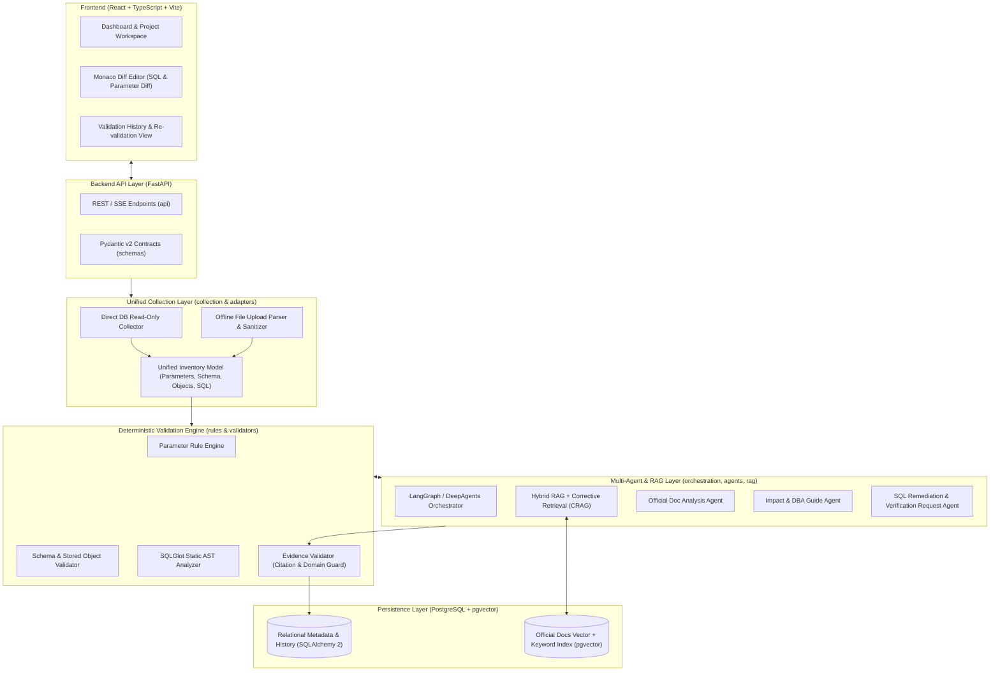

# System Architecture — DB Upgrade Impact Analysis & Validation AI Agent

## 1. Architectural Overview

The **DB Upgrade Impact Analysis & Validation AI Agent** is a hybrid deterministic and Multi-Agent platform that analyzes official DBMS vendor release notes / upgrade documentation and validates how a target version upgrade affects an actual database environment (system parameters, schemas, stored objects, and application SQL workloads).

- **MVP Target**: MySQL 8.0 → MySQL 8.4 Upgrade Analysis & Validation
- **Extensibility Target**: Pluggable DBMS Adapter architecture supporting future expansion to MariaDB, PostgreSQL, and Oracle without modifying core orchestration or validation pipelines.



---

## 2. Monorepo Directory Structure

```text
AIDBUpgrade/
├── AGENTS.md                 # Persistent architecture, security, and development rules
├── README.md                 # Project overview and execution guide
├── .env.example              # Environment variable template
├── .gitignore                # Git ignore configuration
├── docker-compose.yml        # Local infrastructure and service orchestration
├── frontend/                 # React + TypeScript + Vite SPA
├── backend/                  # Python 3.12+ FastAPI + LangGraph + Validation Engine
│   ├── pyproject.toml        # Python dependencies and tooling config
│   ├── alembic/              # Database migration scripts
│   ├── app/                  # Core application source code (16 mandatory packages)
│   │   ├── api/              # FastAPI routers & endpoints
│   │   ├── core/             # Config, security, logging, DB session
│   │   ├── schemas/          # Pydantic v2 request/response & structured output models
│   │   ├── services/         # Application domain services
│   │   ├── repositories/     # SQLAlchemy 2 persistence & pgvector query repositories
│   │   ├── orchestration/    # LangGraph state graphs & multi-agent workflows
│   │   ├── agents/           # LangChain DeepAgents definitions & prompts
│   │   ├── rag/              # Hybrid RAG & Corrective Retrieval pipeline
│   │   ├── rules/            # Deterministic upgrade compatibility rules
│   │   ├── validators/       # SQLGlot analyzer, Parameter/Schema/Evidence validators
│   │   ├── adapters/         # DBMS-specific adapters (MVP: mysql/)
│   │   ├── collection/       # Direct DB & Offline File → Unified Inventory normalizer
│   │   ├── tools/            # Sandboxed agent tools
│   │   ├── mcp/              # Model Context Protocol integrations
│   │   ├── history/          # Validation run history & re-validation comparison
│   │   └── workers/          # Background job workers
│   └── tests/                # Unit, integration, and fixture-based tests
├── collectors/               # Standalone collection SQL scripts & offline file format guides
├── skills/                   # Domain-specific agent skills and rule authoring guides
├── docs/                     # System architecture, requirements, and development plan
└── infra/                    # Dockerfiles, PostgreSQL/pgvector init scripts, deployment configs
```

---

## 3. Backend 16-Package Responsibility Matrix

| Package | Primary Responsibility | Key Constraints |
| :--- | :--- | :--- |
| `api` | HTTP/SSE endpoints, request validation, dependency injection | Thin controllers; delegates business logic to `services` |
| `core` | Settings (`pydantic-settings`), encryption, logging, DB session | Enforces zero-plaintext credential handling and domain allowlists |
| `schemas` | Pydantic v2 DTOs, `InventoryModel`, LLM Structured Output schemas | Strict type validation across API, validators, and agents |
| `services` | Use-case coordination across repositories, validators, and agents | DBMS-agnostic orchestration entry points |
| `repositories` | SQLAlchemy 2.0 CRUD, hybrid search (vector + full-text) queries | Isolates SQL/ORM logic from services |
| `orchestration` | LangGraph workflows coordinating deterministic checks + AI agents | Deterministic step execution with explicit state transitions |
| `agents` | LangChain DeepAgents for doc interpretation, DBA guide, SQL rewrite | Uses Structured Outputs; never overrides deterministic rule failures |
| `rag` | Official doc ingestion, chunking, Hybrid RAG, Corrective Retrieval | Accepts only allowlisted official vendor domains |
| `rules` | Declarative & programmatic rule definitions for version transitions | Version-keyed (e.g., MySQL `8.0` → `8.4`) |
| `validators` | `SQLGlot` AST validator, Parameter Rule Engine, Schema Validator, Evidence Validator | Deterministic execution; flags `INSUFFICIENT_EVIDENCE` when docs lack proof |
| `adapters` | DBMS-specific dialects, catalog queries, parameter semantics | MVP implements `adapters/mysql/`; extensible to MariaDB/PG/Oracle |
| `collection` | Transforms Direct DB metadata or Uploaded Files into `InventoryModel` | Performs PII masking on SQL literals and strict file validation |
| `tools` | Scoped read-only lookup tools exposed to LangChain DeepAgents | No unrestricted shell or host filesystem access |
| `mcp` | Model Context Protocol adapters for external documentation/context | Read-only, domain-restricted |
| `history` | Stores validation snapshots, diffs between runs, re-validation status | Tracks remediation progress over time |
| `workers` | Asynchronous execution of doc indexing and large batch validations | Idempotent task execution |

---

## 4. Core Architectural Mechanisms

### 4.1 Unified Inventory Model (`collection/`)
Whether a user connects directly to a target database (Read-Only) or uploads offline diagnostic files (collected via scripts in `collectors/`), the `collection` pipeline parses, sanitizes (masking PII literals in SQL), and normalizes the input into a single canonical `InventoryModel`:
- **Server Metadata**: DBMS vendor, exact current version, target version, charset/collation defaults, storage engine status.
- **System Parameters**: Variable name, current value, scope, source.
- **Schema & Stored Objects**: Tables, columns, data types, indexes, constraints, partitioning, views, routines (procedures/functions), triggers, events, and user authentication plugins.
- **Application SQL Workload**: Normalized SQL statements, digest/fingerprint, execution frequency metadata, and schema context.

### 4.2 Deterministic Validation vs. AI Agent Boundary
To eliminate hallucinated pass/fail judgments, responsibilities are strictly divided:
1. **Deterministic Validators (`rules/` + `validators/`)**:
   - **Parameter Rule Engine**: Evaluates removed variables, deprecated variables, changed default values, and invalid value ranges between source and target versions.
   - **Schema & Object Validator**: Checks obsolete data types, invalid charsets (e.g., `utf8mb3` deprecation/removal impacts), authentication plugin changes (e.g., `mysql_native_password`), reserved keyword collisions, and routine syntax.
   - **SQLGlot Static Analyzer**: Parses application SQL into an AST to detect removed functions, reserved keyword conflicts, deprecated syntax constructs, and implicit behavior changes.
2. **AI Agents (`agents/` + `orchestration/` + `rag/`)**:
   - **Official Document Analysis**: Extracts and structures version delta knowledge from official release notes and upgrade guides via Hybrid RAG + Corrective Retrieval.
   - **Contextual Impact Explanation**: Explains *why* a detected issue matters in the user's specific environment.
   - **DBA Action Guide Generation**: Produces step-by-step pre-upgrade, during-upgrade, and post-upgrade DBA runbooks.
   - **SQL Remediation & Verification Request Generation**: Proposes candidate rewritten SQL (`Original SQL` vs `Remediated SQL` for Monaco Diff Editor) and generates structured Verification Request documents for application teams.

### 4.3 Evidence Validator & "No Evidence = Not Normal" Principle
Every validation item passes through the **Evidence Validator**:
- Verifies that every rule verdict and AI explanation cites a valid chunk from an **official vendor documentation domain** (`dev.mysql.com`, `downloads.mysql.com` for MySQL).
- If official documentation evidence is missing, ambiguous, or fails relevance grading during Corrective Retrieval, the item **MUST NOT** be judged as `NORMAL` / `COMPATIBLE`. It is explicitly assigned `INSUFFICIENT_EVIDENCE` (`MANUAL_REVIEW_REQUIRED`).

### 4.4 Multi-DBMS Adapter Pattern (`adapters/`)
All DBMS-specific logic implements abstract base interfaces in `backend/app/adapters/base.py`:
- `BaseDBMSAdapter`
- `BaseCollectorAdapter`
- `BaseDialectValidatorAdapter`
- **MVP Implementation**: `backend/app/adapters/mysql/` (MySQL 8.0 → 8.4).
- **Future Extensions (Not implemented in MVP)**: `mariadb/`, `postgresql/`, `oracle/`.

---

## 5. Security Architecture

1. **Read-Only Direct Connection Guard**: Direct DB collectors enforce read-only transaction mode (`SET SESSION TRANSACTION READ ONLY`), reject any non-`SELECT`/`SHOW` query, and enforce strict connection/query timeouts.
2. **Zero Plaintext Credentials**: Target DB credentials are never persisted in plaintext in PostgreSQL, logs, or LangSmith traces.
3. **SQL PII Redaction**: Literal strings and numbers in collected SQL statements are tokenized/masked during ingestion before persistence or LLM prompting.
4. **Offline Upload Quarantine & Validation**: Uploaded files are validated for extension allowlist, size limit, structural schema compliance, and UTF-8 encoding integrity.
5. **No Automatic DB Execution**: Remediated SQL and parameter change scripts are strictly generated as advisory artifacts; the platform never executes mutating commands against target databases.
6. **Official Vendor Documentation Allowlist**: The RAG pipeline and Evidence Validator enforce an explicit URL domain allowlist so unofficial blogs or third-party sources can never be used as validation ground truth.
