# Development Plan — DB Upgrade Impact Analysis & Validation AI Agent

## 1. Development Philosophy & Execution Rules

1. **Incremental Step-by-Step Delivery**:
   - Each development step has a strictly bounded scope and explicit completion criteria.
   - **Never pre-implement features from future steps.**
2. **Verified Official APIs Only**:
   - All backend (Python 3.12+, FastAPI, Pydantic v2, SQLAlchemy 2, Alembic, LangGraph, LangChain DeepAgents, SQLGlot) and frontend (React, TypeScript, Vite, Tailwind CSS, shadcn/ui, TanStack Query, Monaco Diff Editor) code must use current, verified APIs.
3. **Zero Arbitrary Mocks**:
   - Deterministic validators, parsers, and rule engines must be implemented with real logic.
   - Where external live systems (e.g., an external customer's MySQL server or paid LLM API during offline unit tests) are not directly connected, define clean **Abstract Interfaces / Protocols** and validate behavior against realistic **Explicit Test Fixtures** (`backend/tests/fixtures/`).
4. **Test & Report at Every Step**:
   - Every step concludes with automated verification, test execution, and a clear report of created/modified files and test results.

---

## 2. Phased Roadmap

```mermaid
flowchart LR
    S00["STEP 00: Repo Init & Architecture"] --> S01["STEP 01: Backend Core, DB & Unified Inventory Schema"]
    S01 --> S02["STEP 02: Collection Pipeline & MySQL Adapter"]
    S02 --> S03["STEP 03: Hybrid RAG, Official Doc Ingestion & Evidence Validator"]
    S03 --> S04["STEP 04: Deterministic Validators (Parameter, Schema, SQLGlot)"]
    S04 --> S05["STEP 05: Multi-Agent Orchestration (LangGraph / DeepAgents)"]
    S05 --> S06["STEP 06: Validation History, Re-validation & REST APIs"]
    S06 --> S07["STEP 07: Frontend Application & Monaco Diff Workspace"]
    S07 --> S08["STEP 08: E2E Integration Verification & Hardening"]
```

### STEP 00 — Project Initialization & Architecture Rules (Current Step)
- **Scope**:
  - Establish monorepo structure (`frontend`, `backend`, `collectors`, `skills`, `docs`, `infra`).
  - Establish the 16 mandatory backend packages under `backend/app/`.
  - Author `AGENTS.md`, `docs/ARCHITECTURE.md`, `docs/REQUIREMENTS.md`, `docs/DEVELOPMENT_PLAN.md`.
  - Provide `.env.example`, `docker-compose.yml` (PostgreSQL + `pgvector`), `README.md`, and initialize Git.
- **Verification**:
  - Directory & package structure check.
  - Docker Compose configuration validation (`docker compose config`).
  - Git repository initialization check.

### STEP 01 — Backend Core Foundation, Database Models & Unified Inventory Schema
- **Scope**:
  - Setup `backend/pyproject.toml`, FastAPI app entrypoint, `core` settings (`pydantic-settings`), security/encryption utilities, and SQLAlchemy 2 + `pgvector` + Alembic setup.
  - Define canonical `InventoryModel` and domain schemas in `backend/app/schemas/` and relational models in `backend/app/repositories/`.
  - Define abstract DBMS Adapter interfaces in `backend/app/adapters/`.

### STEP 02 — Data Collection Pipeline & MySQL 8.0 Adapter (Direct & Offline Upload)
- **Scope**:
  - Implement MySQL 8.0 read-only direct metadata/SQL collector under `backend/app/adapters/mysql/` and `backend/app/collection/`.
  - Implement offline file upload parser, validator (extension, size, structure, integrity), and SQL literal PII sanitizer.
  - Provide standalone collection SQL scripts and file format guides in `collectors/mysql/`.

### STEP 03 — Official Documentation Hybrid RAG, Corrective Retrieval & Evidence Validator
- **Scope**:
  - Implement official vendor documentation ingestion (`dev.mysql.com` allowlist enforcement), semantic/structural chunking, and `pgvector` + keyword indexing in `backend/app/rag/`.
  - Implement Hybrid RAG + Corrective Retrieval (CRAG) grading pipeline.
  - Implement `EvidenceValidator` enforcing the rule: **Insufficient official documentation evidence must never be judged as `NORMAL` / `PASS`.**

### STEP 04 — Deterministic Validation Engines (Parameter, Schema/Object, SQLGlot)
- **Scope**:
  - Implement MySQL 8.0 → 8.4 rule catalog in `backend/app/rules/`.
  - Implement **Parameter Rule Engine** (removed, deprecated, default-changed, range-changed variables).
  - Implement **Schema & Stored Object Validator** (reserved keywords, charsets, data types, auth plugins, routines).
  - Implement **SQLGlot Static Analyzer** for application SQL compatibility checking.

### STEP 05 — Multi-Agent Orchestration (LangChain DeepAgents & LangGraph)
- **Scope**:
  - Implement specialized agents in `backend/app/agents/` with Pydantic v2 Structured Outputs:
    - Official Documentation Analysis Agent
    - Contextual Impact Explanation Agent
    - DBA Action Guide Agent
    - Application SQL Remediation & Verification Request Agent
  - Connect deterministic validators, Hybrid/Corrective RAG, AI Agents, and `EvidenceValidator` into a cohesive `LangGraph` workflow in `backend/app/orchestration/`.

### STEP 06 — Validation History, Re-validation Engine & Backend API Layer
- **Scope**:
  - Implement validation run persistence, historical comparison (Run $N$ vs Run $N+1$), and re-validation tracking in `backend/app/history/` and `backend/app/services/`.
  - Expose REST/SSE APIs in `backend/app/api/` for collection, validation execution, report export, and history diffing.

### STEP 07 — Frontend Workspace (React + TypeScript + shadcn/ui + Monaco Diff Editor)
- **Scope**:
  - Build the Frontend SPA in `frontend/` using React, TypeScript, Vite, Tailwind CSS, shadcn/ui, and TanStack Query.
  - Implement Inventory Collection UI (Direct DB & File Upload + Collector Guide download).
  - Implement Validation Report Dashboard (Parameters, Schema/Objects, SQL Analysis, Evidence Citations).
  - Integrate **Monaco Diff Editor** for side-by-side Original vs. Candidate Remediated SQL comparison and Verification Request preview.
  - Implement Validation History & Re-validation comparison views.

### STEP 08 — End-to-End Verification, Security Audit & Release Readiness
- **Scope**:
  - Run comprehensive fixture-based and container-based E2E tests covering MySQL 8.0 → 8.4 upgrade scenarios.
  - Verify all security guardrails (read-only DB access, zero plaintext credentials, SQL PII masking, upload validation, domain allowlist).
